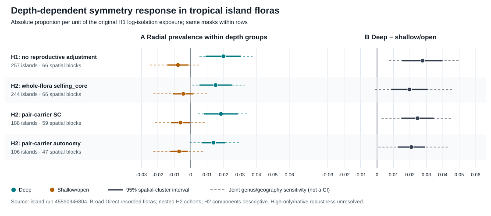

# Candidate companion figure — floral-axis response

The plot uses exact beta, spatial cluster interval and joint-weight range values from [verified result](FLORAL_AXIS_COMPONENT_RESULT.json), run 45590946804. No simulated effect sizes. A: the two depth-specific radial prevalence slopes; B: their paired difference. H1 has two Holm-adjusted component tests; H2 component slopes are descriptive. Solid bars are model-based spatial-cluster intervals, dashed bars are joint genus/geography sensitivity ranges and must not be interpreted as confidence intervals. The four rows overlap and are not independent. This is a figure candidate, not the frozen main Figure 4 or Figure 5.
