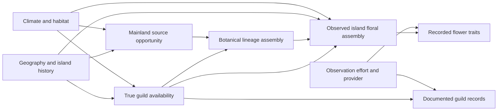

# fd — three-stage floral functional reassembly test plan (2026-11-17)

**Type:** prospective analysis contract, NOT executed or evidence of a pollinator shift. **Main population:** 4,505 GIFT botanical island floras; each outcome has its own observed Direct trait mask. **Branch:** analysis/discrete-functional-hypervolume-20261113. PR #16 remains DRAFT.

## Question and mutually distinguishable hypotheses

Do island floras conserve, lose, or reassemble flower function relative to their potential mainland source, and is any source/genus-adjusted remainder independently associated with documented guild availability?

- H1 **taxonomic assembly:** the original GIFT island plant names and botanical genera are non-exchangeable with source candidate species after source listing breadth and recorded name counts are fixed. This is already supported *descriptively* by the trait-free exact source-name draw; it does NOT identify propagule arrival or establishment.
- H2 **functional composition:** the direction of true species-level paired floral architecture differs by biogeographic region even at matched source candidates; this is already documented for radial×deep but not proven source-independent.
- H3 **guild-mediated functional reassembly:** within original source, geographic, climatic and genus support, verified effort-comparable *effective* guild availability predicts independently measured island-local morphology or floristic deviations. This is currently **not identified**, and GloBI/GBIF non-detection is NOT a guild absence.
- H4 **within-lineage evolutionary change:** island population floral phenotype differs from a demonstrably appropriate mainland population or sister lineage after ancestry, sampling and environment control; this is currently **not identified**.

## Stage 1: 4,505-island global botanical assembly, no flower trait gate

Outcome: island-source genus intersection, and original source-listed island genus pair concentration. Reference: exact without-replacement name draw, fixed observed source-listing breadth bins and original n per bin, separately strict native nonendemic and all-recorded documentation control. Already verified original results: tropical all-recorded 1,018 floras shared-genus deficit **−10.97 [−12.86,−9.35]** block-equal, strict native nonendemic 119 floras **−24.39 [−37.78,−14.23]**; northern midlatitude 1,881 all-recorded **−10.90 [−13.03,−8.97]**, strict native 234 **−16.51 [−21.27,−12.10]**. No inference about actual arrival probabilities or geological origin.

## Stage 2: independently observed flower morphology and finite category diversity

**Separate** (i) local within-island categorical Rao Q; (ii) between-island total-variation functional overlap; (iii) source-relative *directional* category shares; (iv) same-accepted-plant actual paired morphologies; (v) source-genus signed four-part identity. No false continuous 17D KDE volume, no triple-complete 928 restriction. The original 2,324 eligible colour×form floras have mean pairwise TV overlap 0.3869, and zero-shared-species pairs 0.2472, but these numbers alone do NOT demonstrate convergence beyond a genus-conditional null. Source-relative tropical same-plant radial×deep is +10.989 pp (666), high-lat −2.704 pp (135), and exact tropical signed terms +7.309+0.706+11.847−8.873 pp.

**Primary falsification:** out-of-archipelago AND out-of-first-GIFT-source cross-validation. Train separate models on candidate mainland Direct source species only, excluding *all* accepted target island plant species and entire heldout archipelago's source observations. Compare source-region/climate/area/latitude/trait-documentation baseline, source genus-opportunity model, and source genus + separately observed morphology model on EXACT matched islands and species. Group by botanical source provider, 10° block, archipelago and first source entity; report effective independent groups, paired Brier/log-loss, source-balanced cohorts, leave-one-provider-out and native-only. Do not compute significance from millions of correlated island pairs. Distinguish known-island-genus oracle from true genus-arrival prediction.

**Trait source robustness:** numerical NHM corolla cm is useful for independent morphology corroboration but source documents may overlap, and balanced Direct/NHM documentation is scarce (8/425 tropical broad numeric-congener island cases). Do not interpret the +0.1080 Brier gain as observed local island change. Keep unknown native status separate.

## Stage 3: pollinator channel association, only after data qualification

Build island×guild×effort with independent original visitor sources and taxonomy, record positive evidence, quantified survey effort and true absences only when method supports nondetection. Bird, butterfly, Sphingidae, Bombus, other bees, flies are separate. Treat environmental suitability (climate/latitude/elevation), geographical dispersal access (distance, archipelago history), floral source opportunity and documentation intensity as common causes. Do not condition on observed island flora composition if estimating the total effect of guild availability, as it may be a mediator; fit total and genus-conditioned *descriptive* models separately.

Causal graph:

Estimate independently measured guild's incremental heldout predictive improvement over environmental + source + lineage baselines. If adequate mixed-block, same-source guild contrasts are missing, report **NOT_IDENTIFIABLE**, not a zero ecological effect. Current GBIF gate: 3/125 eligible slots, all tropical bird, all intervals cross zero. GloBI deep-flower bird/Lepidoptera documentary support disappears when the globally dominant archive source is omitted. Web of Life and Mangal positive network edges cannot establish effective pollen transfer or historical guild switches.

## Four planned main figures

1. Source and endpoint observation coverage across all 4,505 floras, strict native versus all-recorded.
2. Functional overlap versus taxonomic turnover, full pair distribution and block/archipelago independent summary; include genus-conditioned reference and category state-space normalization.
3. Region-specific source-relative **same-species paired** flower architecture with full uncertainty and exact four signed genus accounting; avoid named pollination syndrome labels.
4. Independent source-only heldout morphology predictions and strict ecological guild identifiability table; SC/autonomous reproductive traits as separate panel or supplement.

## Stop/go rules

- **GO for botanical macroecology** if source-relative regional patterns remain under pre-specified independent block/source/provider and native-status sensitivity; title must refer to recorded floral functional *reassembly* rather than adaptation.
- **NO GO for guild mechanism** unless survey effort supports both states in independent mixed blocks and independent effective guild observations are available; currently no go.
- **NO GO for postcolonization adaptation** without island-local vs mainland-population phenotypes, close-relative phylogenetic support, and reproduction/fitness evidence; currently no go.
- **Geology:** only 425/4,505 have independent oceanic/continental typing. This is a stratified sensitivity, never a stand-in for pollinator loss.

## Exact original audit sources

- [Trait-free genus source null](../results/20261115_global_island_functional_beta/DIRECT_SOURCE_TRAIT_FREE_GENUS_RICHNESS_NULL_4505.md)
- [Finite source and genus-fixed morphology null](../results/20261115_global_island_functional_beta/DIRECT_SOURCE_FINITE_SAMPLING_NULL_GENUS_FILTER_4505.md)
- [Main global figure audit](../results/20261117_global_4505_main_figures/README.md)
- [True paired floral source](../results/20261116_true_joint_pollination_syndrome_source/README.md)
- [Guild source gate](../results/20261116_source_guild_identification/README.md)
- [Independent network evidence](../results/20261117_independent_network_site_preflight/README.md)

**No new source data were run or changed by creating this document.**
