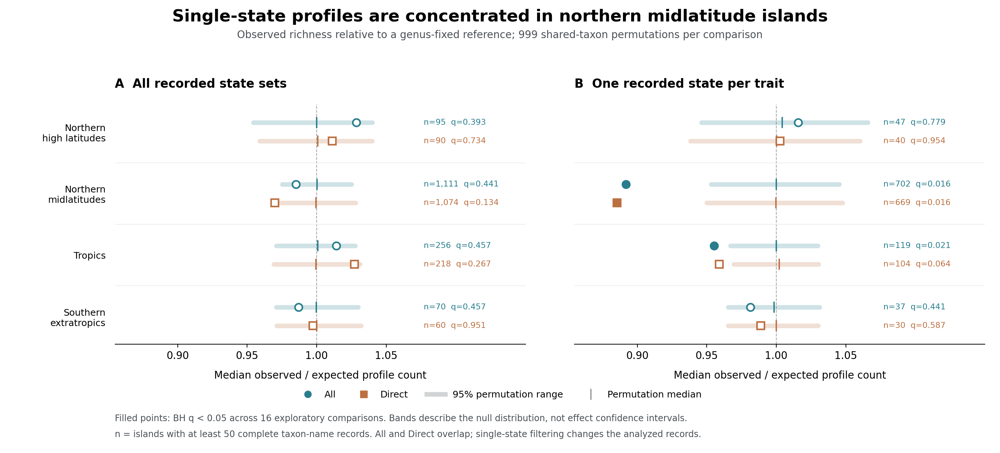
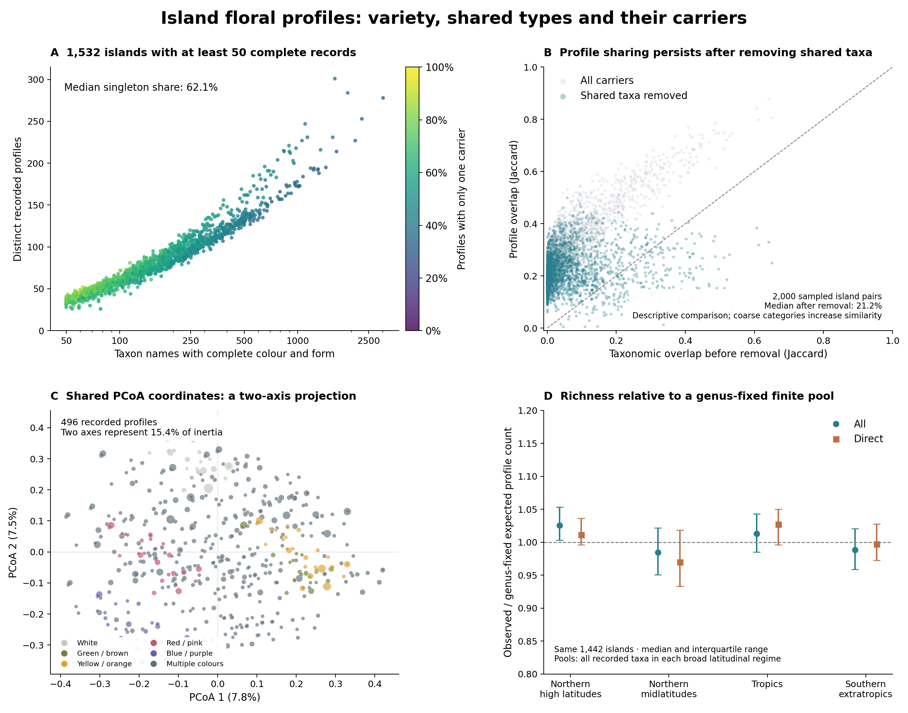

# Island floral profiles: first exploration

**6 November 2026 — exploratory analysis, separate from the Chapter 1 submission.**

北中緯度の島では、花色・花形が各1状態だけ記録された分類群に限定すると、属構成を固定した期待より花プロフィール数が約11%少なかった。複数状態を含む全記録では、この差は多重比較調整後に支持されていない。

## 1. Question, evidence and counting units

**Do different island floras share floral profiles, and how many taxa support each profile?** This analysis separates the number of recorded profiles, their allocation among taxa, and their sharing between islands. It has completed evidence recovery, four scope analyses, common ordination, equal-size rarefaction, and a conditional permutation comparison.

A profile is **the recorded colour-state set paired with the recorded form-state set**. Multiple colours and forms remain one profile; their Cartesian product is never counted as observed flowers. These taxon-level descriptions do not establish which morphs occur together on a particular island.

The source parent is `3bfa818ffbc7a0dea4319933c4b0a0eb41cfabb5`. [Provenance](provenance_manifest.json) records actual input/code hashes, software, and upstream Actions artifacts: trait source run `34191508045` and progressive snapshot run `34232450884`. The [aggregate evidence audit](data_quality_summary.json) documents recovery of **2,847 Direct cells** suppressed by axis-level quality selection: 2,423 form and 424 symmetry cells. The recovery preserves existing Direct evidence and excludes **1,297 ontology-invalid Low cells**. Unspecified descriptions remain missing.

The frozen population contains 106,295 name keys. Excluding 170 uninomial keys and one unresolved name leaves **106,124 taxon-name units**. Complete All records include **231 explicitly marked hybrid names**. Counts therefore refer to retained names, without claiming a new reconciliation of biological species boundaries. Audit coverage before this name filter and final analysis counts have different denominators.

| Evidence scope | Complete names | Distinct profiles | Islands with ≥50 complete names |
| --- | ---: | ---: | ---: |
| All | 16,739 | 496 | 1,532 |
| Direct | 8,455 | 467 | 1,442 |
| All, single state per trait | 7,222 | 54 | 905 |
| Direct, single state per trait | 4,870 | 54 | 843 |

Source: [scope comparison](scope_comparison.csv) and each scope's `summary.json`. All combines Direct with existing validated Low fills; Direct denotes the ledger's evidence class, not exclusively field experiments. Single-state scopes mask records with multiple states in either core trait. These scopes are nested and **are not independent replications**. All has complete profiles on 3,858 islands; 1,532 meet the comparison threshold. Of its 16,739 complete names, 16,725 occur in the corrected flora.

## 2. Completed results

### Many profiles have only one recorded carrier

Across eligible All islands, median complete-name richness is **144**, median profile richness **75**, and median singleton-profile fraction **62.1%**. A singleton here means one retained taxon name carrying that profile on that island. It does not measure pollination-service substitutability or extinction risk.

| Complete-name richness | Islands | Median names | Median profiles | Median singleton fraction |
| --- | ---: | ---: | ---: | ---: |
| 50–99 | 494 | 71 | 47 | 73.6% |
| 100–249 | 645 | 153 | 78 | 61.0% |
| 250–499 | 279 | 330 | 114 | 48.0% |
| 500–999 | 92 | 616 | 153.5 | 40.9% |
| ≥1,000 | 22 | 1,298.5 | 204.5 | 34.3% |

Source: [richness strata](richness_strata.csv). More complete names accompany more profiles and fewer singleton profiles, but even the richest group retains a substantial singleton fraction. This descriptive relationship also reflects finite sampling and categorical compression.

On the **same 1,442 All/Direct islands**, exact rarefaction to 50 names gives a Spearman correlation of **0.9545** and a median paired All-minus-Direct difference of **−0.0036 profiles**. Four-scope common support contains 843 islands. These checks reduce sample-size and island-selection differences; they do not eliminate nonrandom missingness or turn imputation into a controlled treatment. See [matched comparisons](matched_scope_summary.json).

### Different taxa can carry shared profiles

For 2,000 sampled All island pairs, median Jaccard similarity is **0.0350 for complete-profile taxon sets** and **0.2845 for profile sets**. Removing taxa shared by each pair leaves median profile similarity **0.2124**. Sources: [All summary](all/summary.json) and [pairwise values](all/pairwise_comparisons.csv).

This demonstrates recorded profile sharing by different taxa. It does not yet establish excess sharing: coarse categories inherently compress taxonomic differences, and pairs share islands. The current permutation test below concerns within-island profile richness, not pairwise overlap.

### A conditional concentration signal occurs in single-state records

The statistic is the median island ratio `observed profiles / genus-fixed expected profiles`. Expectations use finite sampling without replacement within the union of complete taxa recorded in each broad latitude regime. The pool includes taxa found only on islands below the 50-name threshold.

For each of **four scopes × four regimes**, 999 permutations assign profiles among taxa within genus, using one common assignment across all islands in that regime. This preserves island membership, genus composition, within-genus profile frequencies, and shared-taxon dependence. The denominator remains fixed. Two-sided p-values double the smaller inclusive tail, with numerator/denominator `+1` correction and numerical ties included in both tails. BH adjustment uses the fixed family of 16 comparisons.

| Single-state scope and regime | Islands | Observed ratio | Null median | Null 95% range | Two-sided p | BH q |
| --- | ---: | ---: | ---: | --- | ---: | ---: |
| All: northern midlatitudes | 702 | 0.8918 | 1.0000 | 0.9532–1.0452 | 0.002 | 0.0160 |
| Direct: northern midlatitudes | 669 | 0.8854 | 0.9998 | 0.9500–1.0476 | 0.002 | 0.0160 |
| All: tropics | 119 | 0.9552 | 1.0000 | 0.9670–1.0299 | 0.004 | 0.0213 |
| Direct: tropics | 104 | 0.9591 | 1.0020 | 0.9694–1.0304 | 0.016 | 0.0640 |

Source: [all 16 comparisons](permutation_summary.csv), [null draws](permutation_null_draws.csv.gz), and [design manifest](permutation_manifest.json). Northern midlatitude single-state ratios lie approximately **10.8% and 11.4% below their permutation medians**. The tropical direction agrees across scopes, but Direct does not pass BH 0.05. No multistate-inclusive All or Direct comparison passes BH 0.05; neither northern high-latitude nor southern extratropical single-state comparison does so.

The null centre is estimated from permutations, **not assumed to equal one**; a median of normalized island counts need not be centred exactly at one. The displayed ranges describe the null distribution, not effect confidence intervals. The p-value floor is 0.002. BH is exploratory, and arbitrary-dependence FDR control is not asserted for overlapping scopes. The supported interpretation is conditional profile concentration in a restricted record subset, not general floral convergence or a demonstrated selective mechanism.



**Permutation figure.** Observed regional median ratios are compared with 95% randomization ranges; the bands are null reference ranges, not confidence intervals.

## 3. Common geometry and the hypervolume decision

The common space uses equal-weight mean set-Jaccard dissimilarity for colour and form, followed by square-root transformation and PCoA on **496 unique All profiles**. All scopes map to those coordinates. The transformation was chosen after inspecting geometry and is exploratory.

Two axes retain **15.35%** of positive inertia; 80% requires **17 axes**, and 95% requires **34**. At five axes, only 35.73% is retained and 79 eligible All islands meet the conservative KDE screen `ln(unique profiles) > dimensions`. At six axes, no island meets it; the maximum is 301 profiles. These are measured fidelity/support constraints, not a theorem that every density estimate is impossible. **No Gaussian hypervolume was calculated**, and projected areas are not reported as total floral-space breadth. [Geometry notes](geometry_notes.md) and the [feasibility record](hypervolume_feasibility.json) retain both distance errors and the Lingoes comparison, with methodological references.



**Figure.** A: All island richness and singleton fractions. B: profile sharing before and after shared taxa are removed. C: the two-axis common projection; marker size reflects global carrier counts. D: All/Direct medians and interquartile ranges on the same 1,442 islands. **D shows descriptive island distributions, not permutation intervals.**

The flora records remain opportunistic observations, without validated absences. They include native, introduced and unresolved origins; no native-only filtering was applied. Broad latitude pools are recorded reference sets, not historical colonist pools. Source-dependent coverage, incomplete taxonomic reconciliation, and unmeasured within-genus history remain relevant.

## 4. Replay, validation and release boundary

Restore the private checkpoint **`island_floral_space_inputs_20261106.zip` from the repository root**. Its `work/floral_space_inputs/` tree contains the source ledgers and prepared profiles; `private_analysis/` retains full row-level audit/restart material. The public repository provides code and aggregate results under the [redistribution-rights audit](../../docs/CHAPTER1_DATABASE_RIGHTS_AUDIT.md). It does not provide the restricted source rows needed for a fresh reconstruction.

```bash
unzip island_floral_space_inputs_20261106.zip
python scripts/run_floral_space_exploration.py
OPENBLAS_NUM_THREADS=1 OMP_NUM_THREADS=1 PYTHONPATH=src \
  python -m island_v2.floral_space_null \
  --results results/floral_space_20261106 \
  --flora work/floral_space_inputs/progressive/fixed/canonical/input/chapter1_status_flora.csv.gz \
  --geography results/geography_20260924/corrected_geography_covariates.csv \
  --permutations 999 --min-species 50 --seed 20261106
python scripts/render_floral_space_exploration.py
```

The dated report renderer requires the recorded 50-name eligibility, rarefaction to 50 names, and 999 permutations, and rejects nondefault parameters to avoid misleading labels. The runner regenerates private row-level working outputs as well as aggregates; retain those rows privately. [Provenance](provenance_manifest.json) distinguishes actual hashes from reference releases. **All 57 focused floral-space tests pass, and lint is clean.** The final full suite reports **1,477 passed, 1 skipped and 5 failed**, with exact validation records in [validation.json](validation.json). All five failures were independently reproduced at the unchanged parent commit: four submission-text contract mismatches and one SOCKS dependency initialization failure. See [baseline verification](validation_baseline.md).

## 5. Current position and one next objective

The first exploration has established repeatable profile counts, uneven carrier support, and a northern midlatitude concentration signal restricted to single-state records. **The next main objective is a conditional null for island-pair profile sharing after shared taxa are removed.** Preserve sample size, genus composition and common taxon assignments across islands, then ask whether the observed sharing exceeds that reference. This directly tests the original cross-island question while keeping the current within-island result and its scope limits intact.
