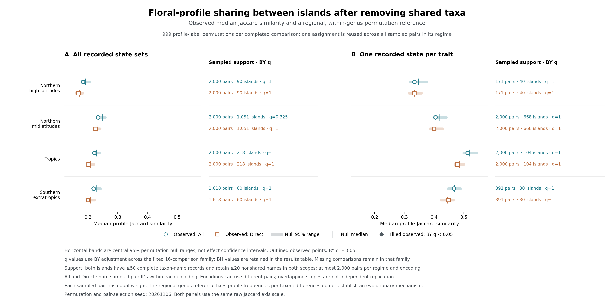

# Conditional floral-profile sharing between island pairs

**Completed: 6 November 2026.** This extension of the [floral-space exploration](../floral_space_20261106/README.md) tests sharing among different recorded taxa after removing names shared by each island pair. **None of the 16 comparisons supports excess sharing or a deficit at BH or BY q < 0.05 under the specified genus/latitude reference.** This is a separate exploratory analysis, outside the Chapter 1 submission analysis.

**日本語の要点:** 共有分類群名を除いた島ペアでは、今回の属・緯度帯条件付き参照を上回る花プロフィール共有は支持されなかった。16比較はBH・BY調整後にいずれも有意でなく、これは同等性や花形質の収斂が存在しないことの証明ではない。先行する島内プロフィール集中の結果は保持する。

## 1. Results and exact scope

The primary effect is the **absolute Jaccard difference**, ΔJ = observed median − median of permutation medians. The strongest unadjusted departure is a **deficit** for full-state All records in northern midlatitudes: observed 0.234330 versus null median 0.247619, ΔJ = −0.013289, p = 0.006, BH q = 0.096, BY q = 0.32455. Its observed/null ratio is 0.9463; this secondary ratio is not the primary effect measure. The central 95% null range is 0.238087–0.258186. Being outside that range does not establish support after the prespecified multiplicity adjustment.

The only positive difference is single-state Direct in southern extratropics, ΔJ = +0.003831 (p = 0.722); single-state Direct in northern high latitudes equals its null median. The other 14 differences are negative. These overlapping comparisons do not provide 16 independent signs or replications. Full results, including all ratios and null ranges, are in [permutation_summary.csv](permutation_summary.csv).

| Encoding / scope | Regime | Observed J | Null median | ΔJ | p | BH q | BY q |
|---|---|---:|---:|---:|---:|---:|---:|
| Full / All | Northern midlatitudes | 0.2343 | 0.2476 | -0.0133 | 0.006 | 0.0960 | 0.3245 |
| Full / All | Northern high latitudes | 0.1836 | 0.1919 | -0.0083 | 0.170 | 0.3886 | 1.0000 |
| Full / All | Tropics | 0.2209 | 0.2289 | -0.0080 | 0.132 | 0.3787 | 1.0000 |
| Full / All | Southern extratropics | 0.2188 | 0.2299 | -0.0111 | 0.078 | 0.3787 | 1.0000 |
| Full / Direct | Northern midlatitudes | 0.2249 | 0.2301 | -0.0052 | 0.282 | 0.4512 | 1.0000 |
| Full / Direct | Northern high latitudes | 0.1675 | 0.1707 | -0.0032 | 0.634 | 0.8453 | 1.0000 |
| Full / Direct | Tropics | 0.2021 | 0.2083 | -0.0063 | 0.254 | 0.4512 | 1.0000 |
| Full / Direct | Southern extratropics | 0.2000 | 0.2093 | -0.0093 | 0.216 | 0.4320 | 1.0000 |
| Single / All | Northern midlatitudes | 0.4048 | 0.4194 | -0.0146 | 0.134 | 0.3787 | 1.0000 |
| Single / All | Northern high latitudes | 0.3333 | 0.3478 | -0.0145 | 0.606 | 0.8453 | 1.0000 |
| Single / All | Tropics | 0.5128 | 0.5200 | -0.0072 | 0.142 | 0.3787 | 1.0000 |
| Single / All | Southern extratropics | 0.4667 | 0.4688 | -0.0021 | 0.890 | 0.9493 | 1.0000 |
| Single / Direct | Northern midlatitudes | 0.4000 | 0.4062 | -0.0062 | 0.746 | 0.8526 | 1.0000 |
| Single / Direct | Northern high latitudes | 0.3333 | 0.3333 | +0.0000 | 1.000 | 1.0000 | 1.0000 |
| Single / Direct | Tropics | 0.4783 | 0.4857 | -0.0075 | 0.134 | 0.3787 | 1.0000 |
| Single / Direct | Southern extratropics | 0.4483 | 0.4444 | +0.0038 | 0.722 | 0.8526 | 1.0000 |



Whiskers show central 95% permutation ranges, **not confidence intervals for the effects**. No equivalence margin or equivalence test was specified. Failure to reject this reference cannot establish absence of convergence or equality of ecological processes.

## 2. Matched support and sampling

For each encoding, both endpoints required at least **50 complete taxon-name records in both All and Direct**. Shared names were removed separately within each scope; each endpoint then required at least **20 nonshared complete names in both scopes**. This operational support rule limits unstable comparisons dominated by very few retained names. It has no special biological or inferential threshold justification and changes the population being described.

Selection used membership and counts, without inspecting profile overlap. Uniform reservoir sampling without replacement retained at most 2,000 qualifying unordered pairs per encoding and regime. All and Direct use **identical sampled pair IDs within an encoding**; full-state and single-state cohorts differ.

| Encoding | Regime | Matched eligible islands | Sampled islands | Supported → sampled pairs |
|---|---|---:|---:|---:|
| Full | Northern midlatitudes | 1,074 | 1,051 | 549,995 → 2,000 |
| Full | Northern high latitudes | 90 | 90 | 2,811 → 2,000 |
| Full | Tropics | 218 | 218 | 22,459 → 2,000 |
| Full | Southern extratropics | 60 | 60 | 1,618 → 1,618 |
| Single | Northern midlatitudes | 669 | 668 | 193,333 → 2,000 |
| Single | Northern high latitudes | 40 | 40 | 171 → 171 |
| Single | Tropics | 104 | 104 | 4,956 → 2,000 |
| Single | Southern extratropics | 30 | 30 | 391 → 391 |

Source: [pair_cohort_audit.csv](pair_cohort_audit.csv). Across encoding/regime cohorts, 835,646 candidate pair slots yielded 775,734 jointly supported slots and 12,180 sampled slots: 7,618 full-state and 4,562 single-state. Slots across encodings can refer to the same physical island pair; there are 11,478 distinct physical pairs across both encodings. Scoring both evidence scopes gives 24,360 pair rows. The full-state sample represents 1,419 islands and the single-state sample 842; these island sets also overlap.

Northern high-latitude single-state support is especially selective: only 171 of 780 candidates remain, although all 40 matched islands are represented. Sampled partner counts there range from 2 to 39 (median 7). The statistic weights **pairs equally**, so islands with more partners contribute more; it is neither an equal-island nor abundance-weighted estimate.

## 3. Frozen conditional reference

The [design](../../docs/superpowers/specs/2026-11-06-floral-profile-pair-sharing-design.md) was frozen before new sharing outcomes at commit `af72c03af7b51714b0cf99e899226e7ce49f021d`. The production code parent is `6bd020439206b8392986cefeb6fc62f0286f813b`; [manifest.json](manifest.json) records actual input/code hashes, software, parameters and random streams.

A full profile is one recorded colour-state set paired with one form-state set; multistate records are not expanded into a Cartesian product. Single-state scopes retain only one recorded state per core trait. All combines Direct evidence with validated Low fills. Direct is the ledger's evidence class, not exclusively field experiments. The retained units are taxon names, including hybrids, rather than fully reconciled biological species ([source definitions](../floral_space_20261106/README.md)).

For pair A,B, delete shared taxon identities **before profile lookup**, then compute J = |profiles(A) ∩ profiles(B)| / |profiles(A) ∪ profiles(B)|. The comparison statistic is the median J across the fixed sampled pairs. For each of four scopes and four regimes, 999 draws permute profiles among complete taxa **within genus and regime**. One assignment per taxon is reused throughout every pair in that comparison. Identity and repeated assignments remain valid draws.

The full regional pool includes taxa recorded only on ineligible or unsampled islands and names removed from particular pair scores. The null preserves pair membership, taxon incidence, retained taxon counts, genus composition and each regional genus's taxon-weighted profile multiset. It **does not fix observed endpoint profile richness**. Regimes use separate conditional references; a taxon occurring in multiple regimes can receive different assignments. These are not a reconstructed global phenotype map, and separate random streams do not make the tests statistically independent.

Two-sided p-values double the smaller inclusive tail, each calculated as (1 + tail count)/(999 + 1), capped at one. Numerical ties enter both tails; minimum p is 0.002. BH uses the fixed family of 16 new pair comparisons; BY supplies a sensitivity adjustment allowing arbitrary dependence. The earlier richness endpoint has its own explicitly separate exploratory family, not an independent replication claim. There are no individual-pair significance tests ([saved draws](permutation_null_draws.csv.gz)).

## 4. Components and interpretation

The descriptive component medians below show **observed → null** for northern midlatitudes. Null entries are medians over draws of each draw's pair median. Endpoint A/B labels follow canonical ordering and have no biological role.

| Northern midlatitude scope | Intersection | Union | Endpoint A profiles | Endpoint B profiles |
|---|---:|---:|---:|---:|
| Full / All | 26 → 28 | 116 → 117 | 70 → 71 | 65 → 66 |
| Full / Direct | 25 → 26 | 113 → 116 | 67 → 69 | 63 → 63 |
| Single / All | 13 → 14 | 32 → 34 | 22 → 23 | 23 → 24 |
| Single / Direct | 12 → 13 | 32 → 34 | 21 → 23 | 22 → 23 |

These diagnostics show that both intersection and endpoint richness can change under this reference. They do not decompose ΔJ additively: median J is not median intersection divided by median union. All regimes' components are retained in the summary, with per-pair observed values and null means/SDs in [pairwise_observed_and_null.csv.gz](pairwise_observed_and_null.csv.gz). No extra component tests were performed. The aggregate nulls are not constant: they contain 18–433 distinct sampled statistics, with the coarser single-state comparisons limited to 18–73.

The [earlier within-island test](../floral_space_20261106/permutation_summary.csv) remains positive for **single-state northern midlatitude concentration**: All and Direct profile-count ratios were approximately 10.8% and 11.4% below their null medians, both BH q = 0.016. All single-state tropics also passed that earlier adjustment (q = 0.0213), whereas Direct tropics did not. Full-state comparisons had no adjusted support. The present northern midlatitude single-state pair differences are −0.014593 for All (BH q = 0.378667) and −0.006250 for Direct (q = 0.852571). Concentration within islands therefore has not established excess sharing between these matched island pairs. Different endpoints and changed cohorts prevent treating the results as contradictory or as a test of alignment conditional on fixed observed richness.

Interpretation remains restricted by coarse categories (54 single-state profiles), overlapping evidence scopes, nonrandom trait coverage and observational flora records. Native, introduced and unresolved origins are all included; no native-only analysis or validated-absence model is used. Genus frequencies are preserved per regional taxon, **not per island occurrence**. Profile associations with taxon range size are randomized and can contribute to departures. Broad latitude pools are operational recorded references, not historical colonist pools. Neither excess nor deficit under this design would by itself demonstrate evolutionary convergence, causal selection or interchangeable pollination services.

## 5. Replay and validation

Restore the existing private checkpoint `island_floral_space_inputs_20261106.zip` from the repository root, following the [prior replay instructions](../floral_space_20261106/README.md#4-replay-validation-and-release-boundary). The public repository supplies code and aggregates under the [rights audit](../../docs/CHAPTER1_DATABASE_RIGHTS_AUDIT.md); restricted taxon-to-profile/source rows remain necessary for reconstruction.

```bash
unzip island_floral_space_inputs_20261106.zip
# Reconstruct prior profile mappings and island metrics if absent.
python scripts/run_floral_space_exploration.py
OPENBLAS_NUM_THREADS=1 OMP_NUM_THREADS=1 PYTHONPATH=src \
  python -m island_v2.floral_space_pair_analysis \
  --results results/floral_space_20261106 \
  --flora work/floral_space_inputs/progressive/fixed/canonical/input/chapter1_status_flora.csv.gz \
  --geography results/geography_20260924/corrected_geography_covariates.csv \
  --output results/floral_space_pairs_20261106 \
  --permutations 999 --min-species 50 --min-unique 20 \
  --max-pairs 2000 --seed 20261106
python scripts/render_floral_space_pairs.py --results results/floral_space_pairs_20261106
```

The recorded test run passed **105 floral tests, including 48 new tests**. The full suite reported **1,525 passed, 5 pre-existing failures and 1 skipped**. The failures concern four existing submission-text contracts and one SOCKS dependency initialization, documented in the [unchanged baseline](../floral_space_20261106/validation_baseline.md).

Independent checks rebuilt all 24,360 observed pair rows from source taxon sets, reconstructed every saved summary statistic and BH/BY adjustment, and replayed the first three joint draws per comparison without calling the production helpers. The maximum numerical discrepancy was 1.11e-16. All 27 manifest file hashes and the eight pre-inference pair selections matched. The actual production figure was visually inspected. See [validation.json](validation.json) for the verification scope, test evidence and final review record.
